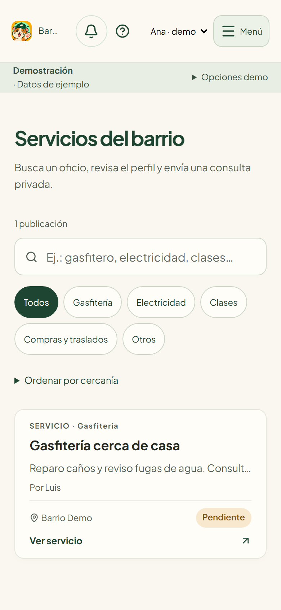
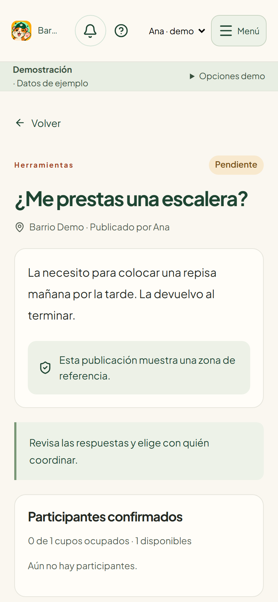
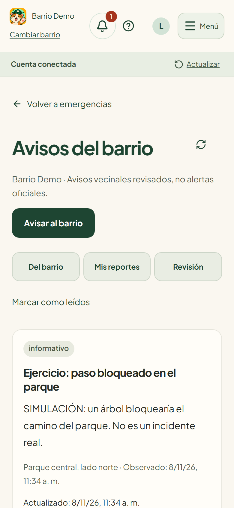
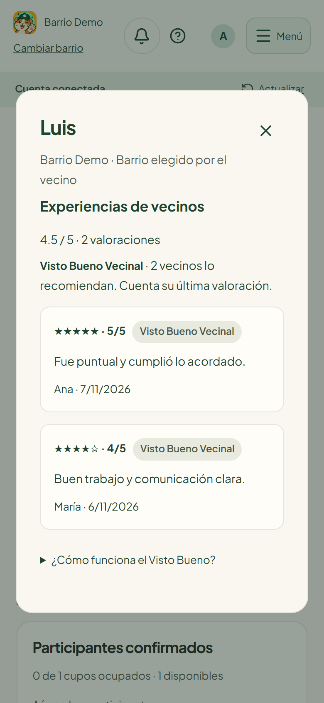
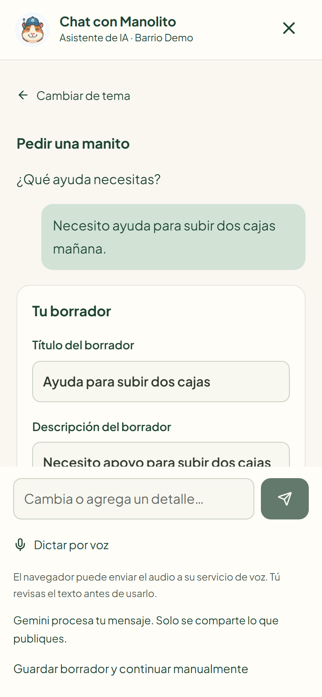
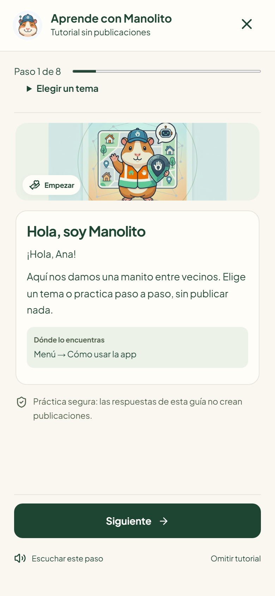

<p align="center"></p>

# Una Manito

**Entre vecinos, nos damos una manito.**

Winners32 · Hackathon UTP 2026

Ana necesita una escalera por una tarde. Luis vive en su barrio y puede prestársela. Con Una Manito, Ana publica el pedido, acepta el ofrecimiento de Luis y ambos acuerdan la entrega por privado. La misma aplicación permite encontrar un gasfitero recomendado y coordinar recursos cuando el barrio enfrenta una emergencia.

**[Abrir la aplicación](https://una-manito-app.vercel.app/) · [Ver la presentación del MVP](docs/Presentacion-Winners32.pdf) · [Consultar el estado frente al reto](docs/ESTADO-MVP.md)**

| Servicios cercanos | Ayuda entre vecinos | Avisos del barrio |
|:---:|:---:|:---:|
|  |  |  |

*Capturas de la aplicación con datos de demostración.*

## Recorrido para el jurado

En la pantalla de acceso, pulsa **Explorar demostración** para probar el recorrido con Ana y Luis. La demo guarda los cambios en ese navegador. Las cuentas registradas comparten publicaciones mediante Supabase.

1. **Buscar un servicio.** Entra en **Buscar un servicio**, busca gasfitería y abre el perfil del prestador. Las estrellas y los comentarios proceden de coordinaciones completadas. Cuatro o cinco estrellas expresan un **Visto Bueno Vecinal**. Su contador toma la última valoración de cada vecino. La consulta privada permite acordar precio y disponibilidad.
2. **Resolver una necesidad.** Como Ana, elige **Pedir una manito**, escribe el pedido de la escalera, revísalo y publícalo. Desde Inicio son tres pulsaciones de botones para el recorrido básico, además de la escritura. Cambia a Luis y ofrece la escalera. Regresa a Ana, acepta la ayuda y marca el pedido como resuelto después de coordinar. Si dos personas responden por el último cupo, el cupo se ocupa al aceptar. La base de datos controla esa aceptación en una transacción.
3. **Coordinar una emergencia.** Abre **Apoyo en emergencia** para consultar necesidades, recursos y contactos. **Avisar al barrio** permite enviar un reporte con foto opcional. El reporte queda privado hasta que un revisor autorizado decide qué compartir. El aviso aprobado aparece dentro de la aplicación para ese barrio.

## Qué más se puede probar

| Función | Qué hace el vecino |
|---|---|
| Productos compartidos | Publica un objeto para préstamo, donación o intercambio. |
| Ubicación aproximada | Elige su barrio y, si concede permiso, añade una ubicación aproximada u ordena publicaciones por cercanía. La residencia es autodeclarada. |
| Manolito e IA | Describe una necesidad, un ofrecimiento o un servicio. Gemini propone un borrador editable. También interpreta búsquedas de oficios entre anuncios existentes. El vecino confirma qué publicar. |
| Tutorial y voz | Abre **Cómo usar la app**, practica sin publicar y dicta texto cuando su navegador ofrece reconocimiento de voz. |
| PWA y uso offline | Después de la primera carga, consulta la guía, una copia guardada y prepara borradores. Publicar, conversar, usar IA y consultar avisos vigentes requiere conexión. |

<details>
<summary><strong>Ver el perfil vecinal, el asistente y el tutorial en el celular</strong></summary>

| Experiencias de vecinos | Borrador de Manolito | Guía interactiva |
|:---:|:---:|:---:|
|  |  |  |

</details>

## Dónde está en el código

| Parte del MVP | Implementación |
|---|---|
| Pantallas y formularios reutilizables en React | [Navegación](src/App.jsx), [accesos desde Inicio](src/components/HomeActions.jsx), [formulario diario](src/components/PublicationComposer.jsx) y [formulario de emergencia](src/components/EmergencyComposer.jsx) |
| Cuentas, barrio y confianza | [Registro y selección de barrio](src/components/AuthFlow.jsx), [perfil y valoraciones](src/components/NeighborProfile.jsx), [ubicación aproximada](src/lib/location.js) |
| Publicaciones y coordinación | [Operaciones con Supabase](src/lib/publications.js), [conversación privada](src/components/PrivateConversation.jsx), [migraciones SQL y permisos](supabase/migrations/) |
| Avisos revisados | [Reporte, revisión y publicación](src/components/NeighborhoodAlerts.jsx) y [clasificación asistida del texto](api/classify-alert.js) |
| IA y tutorial | [Chat](src/components/ManitoChat.jsx), [función de servidor para Gemini](api/prepare-publication.js) y [guía de práctica](src/components/ManolitoTutorial.jsx) |
| PWA | [Manifiesto](public/manifest.webmanifest), [service worker](src/pwa-worker.js) y [copias locales por cuenta y barrio](src/lib/offline.js) |
| Identidad y recursos visuales | [Logo original](public/brand-original.png), [icono de la app](public/manolito-icon-original.png), [ilustración de Manolito](public/manolito-barrio.png), [estilos](src/styles.css) y [capturas](docs/capturas/) |

## Ejecutar en local

Requiere **Node.js 22.12 o posterior**. Desde la raíz del repositorio:

```sh
npm ci
npm run dev
```

Abre la dirección que indique Vite y elige **Explorar demostración**. Para utilizar cuentas conectadas o probar Gemini, copia la [plantilla de configuración](.env.example) a `.env.local`, completa las variables correspondientes y reinicia Vite.

| Variable | Uso |
|---|---|
| `VITE_SUPABASE_URL` y `VITE_SUPABASE_PUBLISHABLE_KEY` | URL y clave **publicable** del proyecto Supabase. |
| `GEMINI_API_KEY` | Clave privada de Gemini, disponible únicamente en el servidor. |
| `GEMINI_MODEL` | Modelo opcional compatible con la función de preparación de publicaciones. |

La instalación conectada parte de las tablas base `perfiles`, `publicaciones` y `ofrecimientos`. Revisa las dependencias y aplica en orden las [migraciones pendientes](supabase/migrations/). Configura las URL de acceso y redirección en Supabase Auth. En Vercel se usa el preset Vite, `npm run build` y la carpeta de salida `dist`. Los datos de ejemplo y los scripts de administración se gestionan aparte del arranque de la demo. [Guía técnica de cupos, permisos, conversaciones e historial](docs/OPERACION.md).

## Pruebas y alcance

```sh
npm run lint
npm test
npm run test:db
npm run build
npx playwright install chromium
npm run test:ui
npm run test:pwa
```

La revisión local documentada el **8 de noviembre de 2026** registró **92 ejecuciones de interfaz aprobadas**, 27 pruebas de lógica, cinco de SQL aislado y cuatro de PWA. Playwright recorre la interfaz móvil y de escritorio. PGlite permite comprobar reglas SQL en una base aislada. Se pueden inspeccionar los casos de [publicación en tres botones](tests/experience.spec.js), [mensajes privados](tests/database/private-messages.test.js), [avisos del barrio](tests/database/alerts.test.js) y [uso sin conexión](tests/pwa.spec.js).

El siguiente paso es validar el MVP con una comunidad piloto, incorporar grupos locales autorizados y medir tareas completadas, tiempos y ayudas resueltas. La revisión humana de avisos y las valoraciones vecinales aportan contexto para decidir. La verificación de residencia, las notificaciones push y la evaluación integral de accesibilidad siguen pendientes. [Fundamentación, referencias ISO y límites de la evaluación](docs/FUNDAMENTACION-Y-DEFENSA.md).

## Equipo Winners32

| Integrante | Rol |
|---|---|
| Sergio Rodrigo Veliz Carrasco | Coordinación técnica e integración |
| Mireya Melissa Montes Acero | Producto y comunicación |
| Wiliam Siesquen Fortunato | Fundamentación técnica y defensa |
| Hans Felipe Cabala Pinto | Experiencia de usuario y demostración |
| Geordan Jesus Justo Apaza | Validación funcional y demostración |
